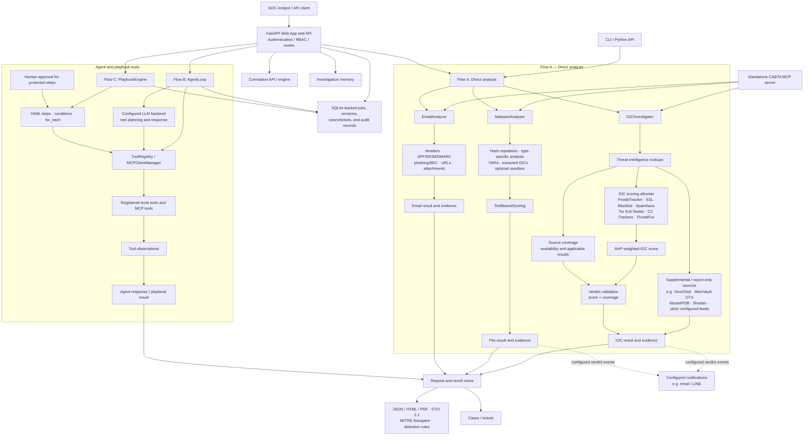

# 🏗️ Architecture Documentation

## Overview

Blue Team Assistant is built with a modular, pipeline-based architecture that allows for easy extension and customization. This document explains the core components and how they interact.

---

## Core Principles

### 1. Separation of Concerns
Each module has a single responsibility:
- **Tools**: Orchestrate analysis workflows
- **Analyzers**: Perform specific file type analysis
- **Integrations**: Connect to external services
- **Scoring**: Calculate threat levels
- **Reporting**: Generate output formats

### 2. Data-Driven Decisions
Direct-analysis verdicts are produced by the deterministic scoring and
validation path for that analysis type. IOC, file, and email analyses use
different evidence and scoring paths; the IOC scoring allowlist is documented
separately below.

The Agent LLM can plan tool calls and summarize observations. It does not
replace or override a deterministic analysis verdict.

### 3. Fail-Safe Behavior
- Missing API keys = reduced functionality, not failure
- Network timeouts = graceful degradation
- Unknown file types = generic analysis
- Optional integrations are initialized on a best-effort basis; failures are logged and dependent functionality degrades gracefully.

---

## Component Architecture



The IOC scoring branch contains exactly six admitted sources. Supplemental
results remain available as evidence; source coverage is calculated separately
from score admission. Coverage classifies applicable source results, while the
Group B sources are excluded from the verdict coverage denominator. The
allowlist and multipliers are defined in
`src/scoring/intelligent_scoring.py`.

In the diagram, “Verdict Validator” refers to deterministic verdict
determination from score and coverage (`determine_verdict`). The separate
`verdict_validator.py` module enforces consistency between that verdict and
optional LLM-generated text.

### IOC scoring components

```text
                    +--------------------------+
                    | IOC Investigator         |
                    | จำแนก IOC / เรียกแหล่งข้อมูล |
                    +------------+-------------+
                                 |
                    +------------v-------------+
                    | Threat Intel Lookups     |
                    +-------+-----------+------+
                            |           |
              +-------------v--+    +---v------------------+
              | แหล่งที่เข้า IOC |    | แหล่งเสริม /        |
              | scoring โดยตรง  |    | report-only         |
              |                 |    | เช่น VT, OTX,       |
              | FeodoTracker    |    | AbuseIPDB, Shodan   |
              | SSL Blacklist   |    +---+------------------+
              | Spamhaus        |        |
              | Tor Exit Nodes  |        +----------+
              | C2 Trackers     |                   |
              | ThreatFox       |                   |
              +--------+--------+                   |
                       |                            |
                       v                            |
              +-------------------+                  |
              | IOC Scoring       |                  |
              | AHP multipliers   |                  |
              +--------+----------+                  |
                       |                             |
                       +-------------+---------------+
                                     |
                         +-----------v-----------+
                         | Source Coverage       |
                         | แยกสถานะ source และ   |
                         | คำนวณ coverage        |
                         +-----------+-----------+
                                     |
                         +-----------v-----------+
                         | Verdict Validator     |
                         | ใช้ score + coverage  |
                         +-----------------------+
```

---

## Data Flow

### IOC Investigation Flow

1. `IOCInvestigator` normalizes and categorizes the submitted IP, domain, URL,
   or file hash, then checks trusted-infrastructure exclusions.
2. `ThreatIntelligence.investigate_ioc_comprehensive()` dispatches only the
   lookups applicable to that IOC type and configured source allowlist.
3. `IntelligentScoring.calculate_ioc_score()` admits only
   `NON_API_SCORING_SOURCES`: FeodoTracker, C2 Trackers, Spamhaus, Tor Exit
   Nodes, SSL Blacklist, and ThreatFox. API/query sources and other feeds can
   remain report evidence without contributing to this score.
4. AHP multipliers are applied to positive source scores. The weighted average
   divides by the sum of the multipliers for the contributing sources. The
   scorer applies a 20% boost when at least two admitted sources are flagged,
   or a 30% boost when at least three are flagged, then clamps the result to
   0–100.
5. Source coverage is calculated independently from score admission. It tracks
   applicable, clean, flagged, unavailable, and stale results; Group B sources
   are excluded from the main coverage denominator. The verdict uses the score
   and coverage together. Unavailable results are not treated as clean.
6. Domain-age and DGA enrichment are returned as analyst context and do not
   enter the IOC score. Optional LLM analysis can explain findings, but the
   deterministic verdict remains authoritative.

### Malware Analysis Flow

`MalwareAnalyzer.analyze()` computes file hashes, checks SHA-256 reputation via
`ThreatIntelligence.investigate_ioc_comprehensive()`, and queries configured
sandbox integrations. It then routes the file to its type-specific analyzer,
runs applicable static and behavioral analyzers (including YARA), extracts
and investigates IOCs, and calculates the file score with `ToolBasedScoring`.
It can also generate MITRE ATT&CK mappings, detection rules, and reports.

### Email Analysis Flow

`EmailAnalyzer` parses message headers, checks email-authentication signals,
inspects phishing/BEC indicators, and analyzes URLs and attachments. Related
IOC and attachment findings are supplemental evidence in the email analysis;
they do not feed the email base score.

---
## Module Descriptions

### tools/

#### `ioc_investigator.py`
Main orchestrator for IOC analysis.

```python
class IOCInvestigator:
    def __init__(self, config: Dict):
        self.threat_intel = ThreatIntelligence(config)
        self.llm_analyzer = LLMAnalyzer(config)
    
    async def investigate(self, ioc: str) -> Dict:
        # 1. Categorize IOC type
        # 2. Check trusted infrastructure whitelist
        # 3. Query threat intelligence sources
        # 4. Calculate threat score
        # 5. Generate detection rules
        # 6. Return comprehensive result
```

#### `malware_analyzer.py`
Main orchestrator for file analysis.

```python
class MalwareAnalyzer:
    def __init__(self, config: Dict):
        self.file_router = FileTypeRouter()
        self.pe_analyzer = PEAnalyzer()
        self.threat_intel = ThreatIntelligence(config)
        # ... more analyzers
    
    async def analyze(self, file_path: str) -> Dict:
        # 1. Detect file type
        # 2. Check hash reputation
        # 3. Run type-specific analyzer
        # 4. Calculate entropy
        # 5. Extract strings and IOCs
        # 6. Scan with YARA
        # 7. Map to MITRE ATT&CK
        # 8. Calculate final score
        # 9. Generate rules and report
```

### analyzers/

#### `pe_analyzer.py`
Windows PE file analysis using pefile.

**Extracted Data:**
- Headers (DOS, NT, Optional)
- Sections (name, entropy, characteristics)
- Imports/Exports
- Resources
- Signatures
- Security features (ASLR, DEP, CFG)

#### `elf_analyzer.py`
Linux ELF binary analysis.

**Extracted Data:**
- ELF header
- Program headers
- Section headers
- Symbol table
- Dynamic linking

#### `office_analyzer.py`
Microsoft Office document analysis using oletools.

**Extracted Data:**
- VBA macros
- OLE streams
- Embedded objects
- Suspicious patterns

### integrations/

#### `threat_intel.py`
Core threat intelligence dispatcher. It selects IOC lookups by indicator type
and configured source allowlist.

**IOC scoring allowlist:** FeodoTracker, C2 Trackers, Spamhaus, Tor Exit Nodes,
SSL Blacklist, and ThreatFox. Other configured IOC integrations provide
supplemental/report evidence and do not enter the IOC scoring formula unless
added to the explicit allowlist. See `docs/API_SOURCES.md` for the current
integration inventory and classifications.

#### `threat_intel_extended.py`
Supplemental reputation, scanning, and sandbox integrations. Being implemented
here does not by itself admit a source to IOC scoring.

**Examples:**
- GreyNoise (scanner detection)
- Censys (certificate data)
- IPQualityScore (fraud detection)
- Hybrid Analysis (sandbox)
- Triage (sandbox)
- ANY.RUN (sandbox)
- Joe Sandbox (sandbox)

#### `llm_analyzer.py`
LLM integration supports configured Ollama, vLLM, and Anthropic backends.

**Usage:**
- Interpret technical findings
- Generate natural language summaries
- Explain MITRE techniques
- Does not set or override direct-analysis verdicts

### scoring/

#### `intelligent_scoring.py`
Multi-signal threat scoring algorithm.

The current application IOC-scoring formula uses an explicit admission policy
with AHP-derived source-specific multipliers. The six sources admitted by the
formula are `feodotracker`, `c2_trackers`, `spamhaus`, `tor_exit_nodes`,
`sslblacklist`, and `threatfox`. This scoring-source list is implemented by
`NON_API_SCORING_SOURCES` and `SOURCE_SCORING_MULTIPLIERS` in
`src/scoring/intelligent_scoring.py`; it is separate from
`GROUP_A_EVAL_SOURCES`, which is evaluation configuration. VirusTotal and
other API/query sources remain report-only. Source availability (`clean`,
`unavailable`, and `stale`) is tracked separately and unavailable must not be
interpreted as clean. The derivation is documented in
`docs/source_weight_ahp_derivation_2026-09-16.md`.

```python
# Current application IOC-scoring admission and source-specific multipliers.
# This is an
# abridged excerpt; the complete AHP derivation is documented in
# docs/source_weight_ahp_derivation_2026-09-16.md.
from src.scoring.intelligent_scoring import (
    NON_API_SCORING_SOURCES,
    SOURCE_SCORING_MULTIPLIERS,
)

class IntelligentScoring:
    @staticmethod
    def calculate_ioc_score(intel_results: Dict) -> int:
        sources = intel_results.get('sources', {})
        weighted_scores = []
        weight_sum = 0.0
        flagged_sources = 0
        for source, result in sources.items():
            source_name = source.lower()
            if source_name not in NON_API_SCORING_SOURCES:
                continue
            if not isinstance(result, dict) or IntelligentScoring._is_source_error(result):
                continue
            if result.get('status') in ('✓', '✓ FLAGGED', 'FLAGGED', 'flagged'):
                flagged_sources += 1
            source_score = IntelligentScoring._get_source_score(result)
            if source_score > 0:
                multiplier = SOURCE_SCORING_MULTIPLIERS[source_name]
                weighted_scores.append(source_score * multiplier)
                weight_sum += multiplier

        base_score = sum(weighted_scores) / weight_sum if weight_sum else 0
        if flagged_sources >= 3:
            base_score = min(100, base_score * 1.30)
        elif flagged_sources >= 2:
            base_score = min(100, base_score * 1.20)
        return max(0, min(100, int(base_score)))
```

Only positive scores from admitted IOC sources enter the weighted average;
its denominator is the sum of their multipliers. Source coverage is calculated
separately. Domain-age, DGA, and LLM-DGA enrichment remain analyst context and
do not enter the IOC score.

#### `false_positive_filter.py`
Reduces false positives through:
- Trusted infrastructure whitelist
- Known good software detection
- Signature validation
- Prevalence checking

### detection/

#### `rule_generator.py`
Generates detection rules from analysis results.

**Formats:**
- YARA (file scanning)
- SIGMA (log detection)
- KQL (Microsoft Defender)
- SPL (Splunk)

---

## Configuration

### config.yaml Structure

```yaml
# Illustrative subset; config.yaml.example is the canonical full template.
api_keys:
  virustotal: ""
  abuseipdb: ""
  shodan: ""
  alienvault: ""
  hybrid_analysis: ""
  greynoise: ""

# LLM Configuration
llm:
  provider: "ollama"    # ollama, vllm, anthropic
  model: "llama3.2:3b"
  api_key: ""
  base_url: "http://localhost:11434"
  vllm_api_key: ""
  vllm_base_url: ""
  vllm_model: ""

# Analysis Settings
analysis:
  max_file_size_mb: 100
  timeout_seconds: 300
  enable_sandbox: true
  enable_yara: true
  enable_llm: true

# Output Settings
output:
  default_format: "cli"  # cli, json, html
  save_reports: true
  report_dir: "./reports"
```

## Configuration and Application Lifecycle

The web factory configures authenticated page/API access and registers
ticketing, agent storage, MCP, notification, Gmail OAuth, correlation,
memory, and route-level authorization components. It attempts to initialize
optional runtime components on a best-effort basis. If an optional component
cannot be initialized, the failure is logged and dependent functionality
degrades gracefully; dependent routes may return `503` as described under
Fail-Safe Behavior.

`CorrelationEngine` and `InvestigationMemory` are initialized by
`src/web/app.py:create_app` when available. The correlation engine is consumed
by `/api/agent/correlation/{session_id}`. Investigation memory is consumed by
`/api/agent/memory/ioc/{ioc}` and `/api/agent/memory/stats`.

---

## Extending the System

### Adding a New File Analyzer

1. Create `src/analyzers/new_analyzer.py`:

```python
class NewAnalyzer:
    def analyze(self, file_path: str) -> Dict:
        return {
            'file_type': 'new_type',
            'analysis': {...}
        }
```

2. Register in `file_type_router.py`:

```python
self.analyzers['new_type'] = NewAnalyzer()
```

3. Add to `malware_analyzer.py`:

```python
if file_type == 'new_type':
    result = self.new_analyzer.analyze(file_path)
```

### Adding a New TI Source

1. Add method in `threat_intel_extended.py`:

```python
async def check_new_source(self, ioc: str) -> Dict:
    # API call implementation
    return {
        'source': 'NewSource',
        'found': True/False,
        'data': {...}
    }
```

2. Complete the admission and AHP review before adding a source to application
   IOC scoring. The source must be added to the explicit
   `SOURCE_SCORING_MULTIPLIERS`/`NON_API_SCORING_SOURCES` policy with a
   documented derivation; do not assign an arbitrary integer weight:

```python
# See docs/source_weight_ahp_derivation_2026-09-16.md for the required
# evidence, pairwise comparison, priority vector, and multiplier mapping.
```

---

## Performance Considerations

### Async Architecture
All network operations use `asyncio` for non-blocking I/O:
- Parallel API calls
- Timeout handling
- Graceful degradation

### Caching
Future enhancement: Add caching layer for:
- TI API responses
- File hashes
- Analysis results

### Rate Limiting
Built-in availability handling:
- Source-specific API/query limits remain constraints for report-only sources
- ThreatFox uses the 15-second production deadline; timeout means unavailable,
  no retry, no pipeline block, and exclusion from that round's score
- Unavailable results are never interpreted as clean

---

## Security Considerations

### Authentication and Authorization
- Browser pages are protected by `PageAuthMiddleware`.
- Protected API routes use `get_current_user`; selected routers/routes also
  apply `require_role(...)`.
- Resource ownership and visibility checks are route-specific; this document
  does not claim that every route has identical authorization behavior.
- Human approval checks apply to selected agent actions, not universally to
  every route.

### API Key Storage
- Keys stored in `config.yaml`
- File should have restricted permissions
- Never commit to version control

### Input Validation
- File size limits
- Type validation
- Path traversal prevention

### Output Sanitization
- HTML escaping in reports
- No arbitrary code execution
- Safe string handling
